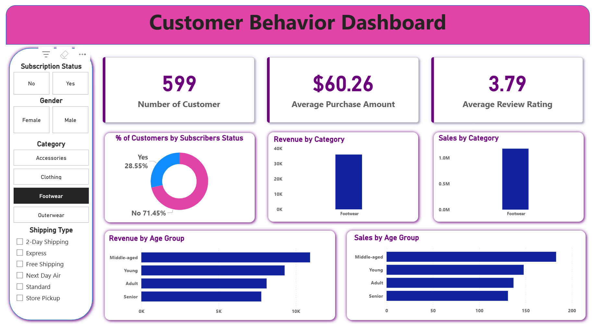

# Retail Customer Behavior Analytics

## 📌 Project Overview
This project is an end-to-end data analytics case study focused on understanding **customer shopping behavior in a retail environment**. The objective is to analyze transactional customer data and generate actionable business insights using **Python, SQL, and Power BI**, following a real-world, company-style analytics workflow.

The project simulates how data analysts work in organizations — starting from raw data, performing analysis, answering business questions, and delivering insights through an interactive dashboard for decision-makers.

---

## 🎯 Business Problem Statement
Retail businesses need to understand:
- How customers behave across different product categories
- Which customer segments contribute the most to revenue
- Purchasing patterns that can drive targeted marketing and retention strategies

This project aims to analyze customer shopping data to uncover trends, segment customers, and support data-driven business decisions.

---

## 📂 Dataset Description
- **Dataset:** Retail Customer Shopping Behavior
- **Format:** CSV
- **Content Includes:**
  - Customer demographics
  - Product categories
  - Purchase amounts
  - Shopping frequency
  - Payment methods
  - Seasonal trends

The dataset represents anonymized, structured transactional data suitable for analytical use cases.

---

## 🛠️ Tools & Technologies Used
- **Python:** pandas, numpy, matplotlib, seaborn  
- **SQL:** MySQL (business-driven analytical queries)  
- **Power BI:** Interactive dashboards and KPI visualization  
- **Jupyter Notebook:** Analysis and documentation  
- **GitHub:** Version control and project presentation  

---

## 🔄 Project Workflow
1. **Data Loading & Cleaning (Python)**
   - Imported raw CSV data
   - Handled missing values and inconsistencies
   - Prepared data for analysis

2. **Exploratory Data Analysis (EDA)**
   - Analyzed customer demographics and purchase patterns
   - Identified high-level trends and anomalies
   - Generated insights to guide business questions

3. **Business Analysis Using SQL**
   - Created structured tables for querying
   - Answered business questions such as:
     - Top-performing product categories
     - Customer spending behavior
     - Segment-wise purchase trends
     - High-value customer identification

4. **Dashboard Development (Power BI)**
   - Designed an interactive dashboard
   - Visualized KPIs and trends
   - Enabled filtering by customer attributes and categories

---

## 📊 Power BI Dashboard Insights
The Power BI dashboard provides:
- Customer segmentation overview
- Revenue and purchase distribution
- Category-wise performance
- Spending behavior across demographics
- Interactive filters for deeper analysis

This dashboard is designed for business stakeholders to quickly interpret insights and make informed decisions.

## 📊 Power BI Dashboard

---

## 📈 Key Insights
- Certain customer segments contribute disproportionately to overall revenue
- Specific product categories drive repeat purchases
- Seasonal trends significantly impact shopping behavior
- Data-driven segmentation can improve marketing efficiency

---

## 🚀 Business Impact
- Helps retailers understand customer behavior patterns
- Supports targeted marketing and customer retention strategies
- Enables management to make data-backed decisions using dashboards

---

## 📁 Repository Structure
